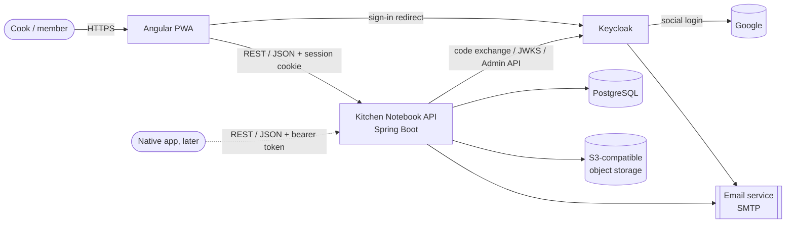
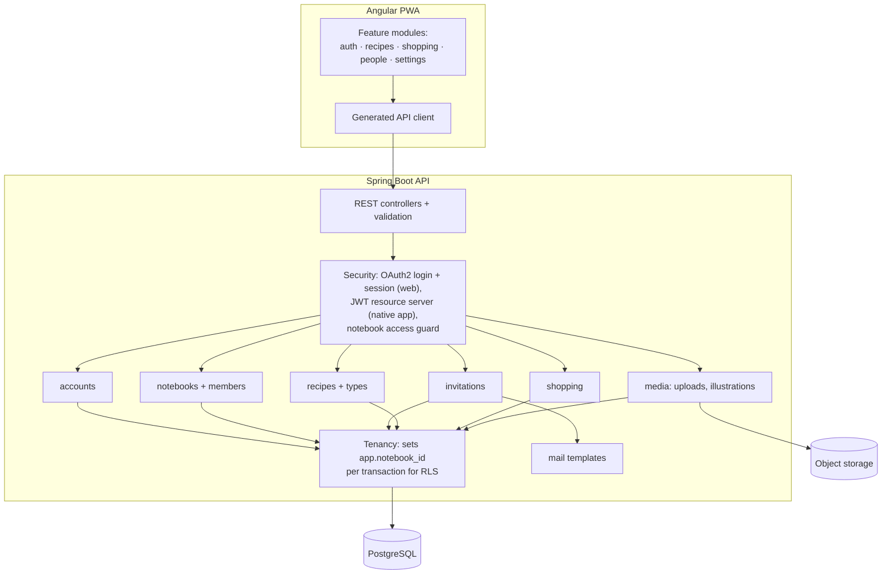
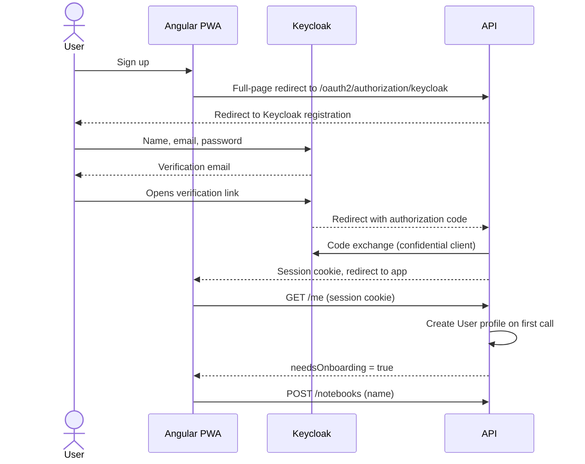
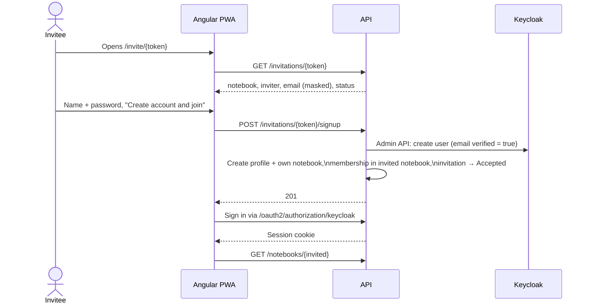
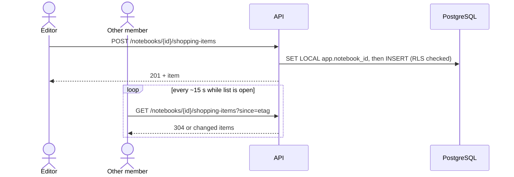

# Architecture (arc42, condensed)

> Status: draft v0.1 · 2026-11-22. Hosting is **not decided yet**; everything below is hosting-neutral (containers).

## 1. Goals and quality requirements

| Priority | Quality goal | Scenario |
|---|---|---|
| 1 | **Tenant isolation** | A user can never read or change data of a notebook they are not a member of — even with a bug in a query (defence in depth via PostgreSQL RLS). |
| 2 | **Security** | Standard OIDC with Keycloak; no passwords in the app; invitation tokens single-use and hashed. |
| 3 | **Simplicity** | One deployable backend (modular monolith), one SPA, no message broker in v1. |
| 4 | **Usability on phones** | Responsive PWA, fast first load, works on mobile browsers. |
| 5 | **Maintainability** | Spec-driven: specs + OpenAPI contract + tests; modules with clear boundaries. |

## 2. Constraints

- Backend: **Java 25 (LTS)**, **Spring Boot 4.x** (latest stable at project start; Spring Boot has no LTS line — 4.1 is current, 4.2 due end of 2026).
- Database: **PostgreSQL** (current major, e.g. 17/18).
- Frontend: **Angular 22** (current major, LTS until June 2028; next major June 2027), as a **PWA**.
- Identity: **Keycloak 26.x**, self-hosted.
- English only at launch; online only; no live push.

## 3. Context

## 4. Solution strategy

- **Modular monolith** in Spring Boot with modules matching the bounded contexts (`accounts`, `notebooks`, `invitations`, `recipes`, `shopping`, `media`). Module boundaries checked with **Spring Modulith** (decision pending, see ADR list).
- **REST API, contract-first** with OpenAPI; Angular client generated from the spec.
- **Tenancy**: shared schema, `notebook_id` on every tenant table, **PostgreSQL row-level security** as a second safety net behind service-level authorisation.
- **Keycloak** owns credentials and sign-in methods; the app stores a user profile keyed by the Keycloak `sub`.
- **Web sign-in through the backend** (ADR-009, proposed): the backend is the OAuth2 client and gives the browser a session cookie; a later native app uses bearer tokens against the same endpoints.
- **Short polling** for the shopping list (no WebSocket/SSE in v1).

## 5. Building blocks

## 6. Runtime views

### 6.1 Sign-up with email and verification

### 6.2 Accepting an invitation without an account

Invitee with an account: sign in first, then `POST /invitations/{token}/accept`; the API checks that the invitation email equals the signed-in user's verified email (else 409 → wrong-account screen).

### 6.3 Shopping list update and polling

## 7. Deployment (open)

Containers: `api` (Spring Boot), `web` (static Angular build behind a reverse proxy/CDN), `keycloak`, `postgres` (managed preferred), object storage (S3-compatible), SMTP provider.
Hosting options to decide: Kubernetes with Helm (familiar, more ops) vs a managed container platform. Data residency (Switzerland / EU) to be decided.

## 8. Cross-cutting concepts

| Topic | Approach |
|---|---|
| **Authentication** | Keycloak realm `kitchen-notebook`; Google identity provider; email + password; verify email required; password reset via Keycloak. Web: the backend is a confidential OAuth2 client (`kn-web`) and issues a session cookie. Native app (later): public client (`kn-mobile`) with PKCE, bearer JWTs. See ADR-009. |
| **Authorisation** | Per request: resolve membership of the user in `{notebookId}` → role. Guard by role (Owner / Can edit / Can view). No roles in the JWT for notebook access (memberships live in the app DB). |
| **Tenancy / RLS** | Each transaction sets `SET LOCAL app.notebook_id` and `app.user_id`; RLS policies restrict rows to that notebook. App connects as a non-owner role so RLS cannot be bypassed. |
| **Persistence** | Spring Data JPA (or jOOQ — to decide), Flyway migrations, UUID keys, optimistic locking (`version`) on recipes and shopping items. |
| **Sessions / CSRF** | Spring Session JDBC in PostgreSQL (works with 2+ instances); session holds authentication only. CSRF via `CookieCsrfTokenRepository` and Angular's XSRF support, for the session chain only. |
| **API** | REST, OpenAPI 3.1 contract-first, problem details (RFC 9457) for errors, ETags for polling. |
| **Media** | Upload via API (or pre-signed URL), validate type/size (JPG/PNG ≤10 MB), generate resized WebP variants, store in object storage; illustrations shipped as static SVG assets. |
| **Email** | Keycloak sends verification and reset emails; the API sends invitation emails (templated, English). |
| **i18n** | English only, but Angular built with i18n extraction from day one so German can be added later. |
| **Observability** | Structured JSON logs, Micrometer metrics, OpenTelemetry traces; health endpoints via Actuator. |
| **Testing** | Unit tests; Testcontainers (PostgreSQL, Keycloak) for integration tests including RLS tests; contract tests against the OpenAPI spec; Playwright E2E for main flows. |
| **Privacy (nDSG / GDPR)** | Account deletion per SET-51; minimal personal data; retention periods to define. |

## 9. Tech stack

| Layer | Choice | Version (as of 2026-11) |
|---|---|---|
| Language | Java | 25 LTS |
| Backend framework | Spring Boot (Web, Security OAuth2 Client + Resource Server, Spring Session JDBC, Data JPA, Validation, Actuator) | 4.x latest stable |
| Database | PostgreSQL + Flyway | 17/18 |
| Identity | Keycloak (OIDC, Google IdP) | 26.8.x |
| Frontend | Angular (standalone components, signals, zoneless), PWA (service worker for app shell only) | 22 |
| UI components | Fluent 2-inspired theme — implementation library to decide (see open decisions) | — |
| API contract | OpenAPI 3.1, generated TypeScript client | — |
| Object storage | S3-compatible | provider open |
| Email | SMTP provider | provider open |
| Build / CI | Maven or Gradle (to decide), GitHub Actions (to confirm) | — |
| Tests | JUnit 5, Testcontainers, Playwright | — |

## 10. Architecture decisions (ADR list)

| ADR | Decision | Status |
|---|---|---|
| ADR-001 | Spring Boot 4 on Java 25 | Accepted |
| ADR-002 | Angular PWA (one responsive app, no native apps) | Accepted |
| ADR-003 | Keycloak as self-hosted IdP (Google + email/password, no magic link) | Accepted |
| ADR-004 | Shared schema + PostgreSQL RLS for tenancy | Accepted |
| ADR-005 | Short polling instead of push for the shopping list | Accepted |
| ADR-006 | Modular monolith (Spring Modulith?) | Proposed |
| ADR-007 | Hosting platform | Open |
| ADR-008 | Sign-in UI: Keycloak theme vs Angular screens | Open |
| ADR-009 | Session cookies from the backend for the web; bearer tokens for a later native app (hybrid, no separate BFF) | Proposed |
| ADR-010 | Fluent 2 look in Angular: library choice | Open |

### ADR-009 Token handling (proposed)

**Context.** The web PWA comes first; a second backend instance and a native mobile app are likely later.

**Proposed decision: hybrid in the backend (option B).**

- **Web:** the backend is a confidential OAuth2 client (`kn-web`, `oauth2Login()`). Tokens stay on the server; the browser gets an `HttpOnly`, `Secure`, `SameSite=Lax` session cookie. Login starts with a full-page redirect to `/oauth2/authorization/keycloak`; API calls answer 401 instead of redirecting.
- **Native app (later):** public client `kn-mobile`, Authorization Code + PKCE through the system browser (RFC 8252), bearer JWTs with audience `kn-api`.
- **Two `SecurityFilterChain`s on the same endpoints:** requests with `Authorization: Bearer` go to the JWT resource-server chain (stateless, no CSRF); all others go to the session chain (CSRF on).
- **`CurrentUser` abstraction:** resolves the Keycloak `sub` from an `OidcUser` or a `Jwt`, so membership checks and RLS don't depend on the sign-in path.
- **Sessions:** Spring Session JDBC in PostgreSQL, so 2+ instances work without sticky sessions. The session holds authentication only.
- **Same origin:** SPA and API behind one reverse proxy (`/api`), so cookies stay first-party.
- **Logout:** RP-initiated logout to Keycloak; "Sign out everywhere" via OIDC back-channel logout.

**Options considered.**

| | A: Tokens everywhere | B: Hybrid in the backend | C: Separate BFF for the web |
|---|---|---|---|
| Web PWA | Tokens in the SPA (PKCE) | Session cookie from the backend | Session cookie from the BFF |
| Native app | Bearer token | Bearer token | Bearer token |
| API | Stateless resource server | Session chain + JWT chain | Stateless resource server |
| With 2 instances | Nothing extra | Spring Session JDBC | Session store in the BFF |
| Deployables | API | API | API + BFF |
| Tokens exposed to XSS | Yes | No | No |
| CSRF handling | Not needed | Session chain only | In the BFF |

**Consequences.** No tokens in browser JavaScript and no OIDC library in Angular. The backend becomes stateful for web requests and needs a session store. Two sign-in paths to test (Testcontainers with Keycloak covers both).

## 11. Risks and technical debt

- **Custom sign-in screens vs Keycloak:** the canvas designs custom sign-in / sign-up / invite screens. With standard OIDC these are Keycloak pages and need a Keycloak theme (e.g. Keycloakify) to match; fully custom Angular screens would need non-standard flows. → ADR-008.
- **Invitation sign-up without verification** requires creating users via the Keycloak Admin API with `emailVerified=true`; the API needs a service account with narrow permissions.
- **Session handling:** sessions, CSRF and the session timeout need care; shopping-list polling every ~15 s keeps sessions alive, so set an absolute timeout and map "Keep me signed in" to it.
- **RLS + connection pooling:** settings must be `SET LOCAL` inside transactions to avoid leaking between pooled connections.

## Open decisions (need your input)

1. **ADR-007 Hosting** and data residency.
2. **ADR-008 Sign-in UI**: theme Keycloak to match the design, or accept Keycloak's standard pages styled lightly?
3. **ADR-009 Tokens**: confirm the proposed hybrid (session cookies for the web, bearer tokens for a later native app).
4. **ADR-010 Fluent look**: Fluent UI Web Components in Angular, or Angular Material/CDK themed to Fluent tokens, or own components on Angular CDK?
5. Maven or Gradle; JPA or jOOQ; GitHub Actions?
6. Object storage and email providers.
