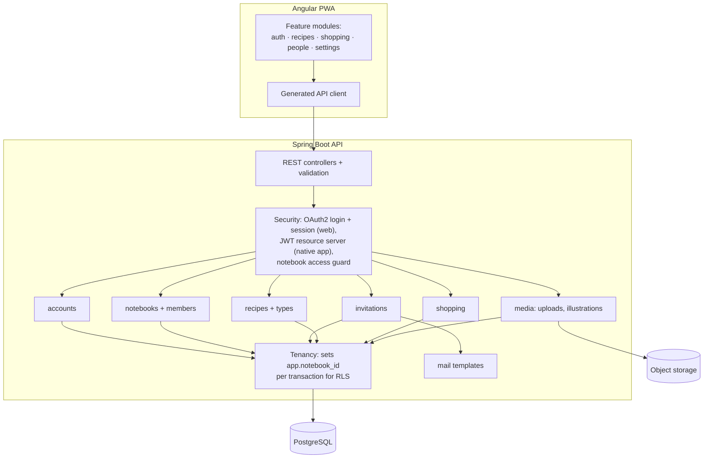
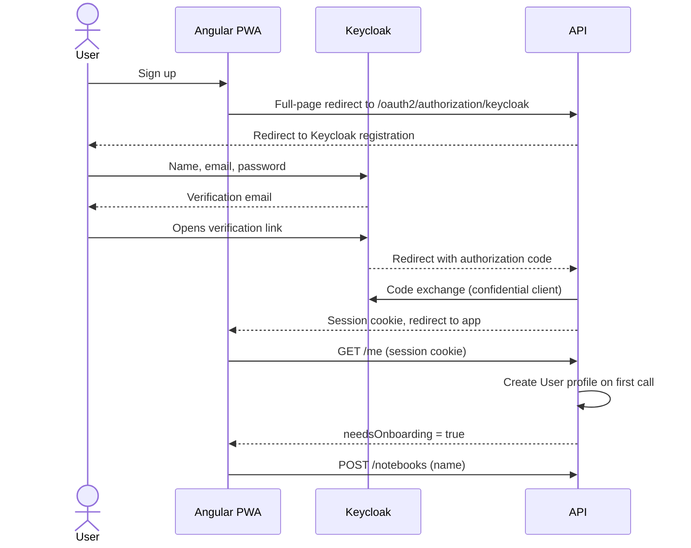
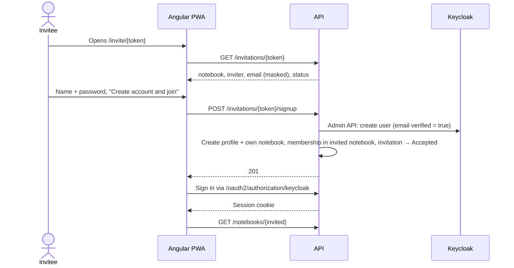
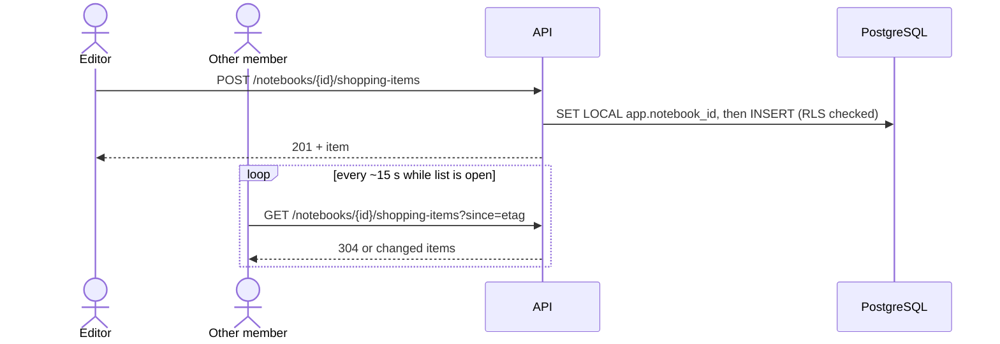

# Architecture (arc42, condensed)

> Status: draft v0.2 · 2026-11-22. Hosting is **not decided yet**; everything below is hosting-neutral (containers).

## Table of contents

- [1. Goals and quality requirements](#1-goals-and-quality-requirements)
- [2. Constraints](#2-constraints)
- [3. Context](#3-context)
- [4. Solution strategy](#4-solution-strategy)
- [5. Building blocks](#5-building-blocks)
- [6. Runtime views](#6-runtime-views)
  - [6.1 Sign-up with email and verification](#61-sign-up-with-email-and-verification)
  - [6.2 Accepting an invitation without an account](#62-accepting-an-invitation-without-an-account)
  - [6.3 Shopping list update and polling](#63-shopping-list-update-and-polling)
- [7. Deployment (open)](#7-deployment-open)
- [8. Cross-cutting concepts](#8-cross-cutting-concepts)
- [9. Tech stack](#9-tech-stack)
- [10. Architecture decisions (ADR index)](#10-architecture-decisions-adr-index)
- [11. Risks and technical debt](#11-risks-and-technical-debt)
- [Open decisions (need your input)](#open-decisions-need-your-input)

## 1. Goals and quality requirements

| Priority | Quality goal            | Scenario                                                                                                                                         |
| -------- | ----------------------- | ------------------------------------------------------------------------------------------------------------------------------------------------ |
| 1        | **Tenant isolation**    | A user can never read or change data of a notebook they are not a member of — even with a bug in a query (defence in depth via PostgreSQL RLS). |
| 2        | **Security**            | Standard OIDC with Keycloak; no passwords in the app; invitation tokens single-use and hashed.                                                   |
| 3        | **Simplicity**          | One deployable backend (modular monolith), one SPA, no message broker in v1.                                                                     |
| 4        | **Usability on phones** | Responsive PWA, fast first load, works on mobile browsers.                                                                                       |
| 5        | **Maintainability**     | Spec-driven: specs + OpenAPI contract + tests; modules with clear boundaries.                                                                    |

## 2. Constraints

- Backend: **Java 25 (LTS)**, **Spring Boot 4.x** (latest stable at project start; Spring Boot has no LTS line — 4.1 is current, 4.2 due end of 2026).
- Database: **PostgreSQL** (current major, e.g. 17/18).
- Frontend: **Angular 22** (current major, LTS until June 2028; next major June 2027), as a **PWA**.
- Identity: **Keycloak 26.x**, self-hosted.
- English only at launch; online only; no live push.

## 3. Context

## 4. Solution strategy

- **Modular monolith** in Spring Boot with modules matching the bounded contexts (`accounts`, `notebooks`, `invitations`, `recipes`, `shopping`, `media`). Plain packages by convention, layering checked with **ArchUnit** (Spring Modulith rejected, [ADR-006](adr/0006-modular-monolith-spring-modulith.md)).
- **REST API, design-first**: hand-written `api/openapi.yaml` (OpenAPI 3.1); Spring interfaces and DTOs generated with OpenAPI Generator, Angular client with `ng-openapi-gen` ([ADR-011](adr/0011-design-first-openapi-codegen.md)).
- **Tenancy**: shared schema, `notebook_id` on every tenant table, **PostgreSQL row-level security** as a second safety net behind service-level authorisation.
- **Keycloak** owns credentials and sign-in methods; the app stores a user profile keyed by the Keycloak `sub`.
- **Web sign-in through the backend** ([ADR-009](adr/0009-session-cookies-web-bearer-native.md), accepted): the backend is the OAuth2 client and gives the browser a session cookie; a later native app uses bearer tokens against the same endpoints.
- **Short polling** for the shopping list (no WebSocket/SSE in v1).

## 5. Building blocks

## 6. Runtime views

### 6.1 Sign-up with email and verification

### 6.2 Accepting an invitation without an account

Invitee with an account: sign in first, then `POST /invitations/{token}/accept`; the API checks that the invitation email equals the signed-in user's verified email (else 409 → wrong-account screen).

### 6.3 Shopping list update and polling

## 7. Deployment (open)

Containers: `api` (Spring Boot), `web` (static Angular build behind a reverse proxy/CDN), `keycloak`, `postgres` (managed preferred), object storage (S3-compatible), SMTP provider.
Hosting options to decide: Kubernetes with Helm (familiar, more ops) vs a managed container platform. Data residency (Switzerland / EU) to be decided.

## 8. Cross-cutting concepts

| Topic                     | Approach                                                                                                                                                                                                                                                                                                        |
| ------------------------- | --------------------------------------------------------------------------------------------------------------------------------------------------------------------------------------------------------------------------------------------------------------------------------------------------------------- |
| **Authentication**        | Keycloak realm`kitchen-notebook`; Google identity provider; email + password; verify email required; password reset via Keycloak. Web: the backend is a confidential OAuth2 client (`kn-web`) and issues a session cookie. Native app (later): public client (`kn-mobile`) with PKCE, bearer JWTs. See [ADR-009](adr/0009-session-cookies-web-bearer-native.md). |
| **Authorisation**         | Per request: resolve membership of the user in`{notebookId}` → role. Guard by role (Owner / Can edit / Can view). No roles in the JWT for notebook access (memberships live in the app DB).                                                                                                                    |
| **Tenancy / RLS**         | Each transaction sets`SET LOCAL app.notebook_id` and `app.user_id`; RLS policies restrict rows to that notebook. App connects as a non-owner role so RLS cannot be bypassed.                                                                                                                                    |
| **Persistence**           | Spring Data JPA (jOOQ rejected), `ddl-auto=validate`, `open-in-view=false`, Flyway migrations (owner role), UUIDv7 keys, optimistic locking (`version`) in the base entity. Every query on a tenant table filters on `notebookId` explicitly. See `docs/development/backend.md`. |
| **Sessions / CSRF**       | Spring Session JDBC in PostgreSQL (works with 2+ instances); session holds authentication only. CSRF via`CookieCsrfTokenRepository` and Angular's XSRF support, for the session chain only.                                                                                                                     |
| **API**                   | REST under `/api`, OpenAPI 3.1 design-first with generated server interfaces and client (ADR-011), problem details (RFC 9457, `urn:kn:problem:<slug>`) for errors, ETags for polling.                                                                                                                         |
| **Media**                 | Upload via API (or pre-signed URL), validate type/size (JPG/PNG ≤10 MB), generate resized WebP variants, store in object storage; illustrations shipped as static SVG assets.                                                                                                                                  |
| **Email**                 | Keycloak sends verification and reset emails; the API sends invitation emails (templated, English).                                                                                                                                                                                                             |
| **i18n**                  | English only, but all text comes from translation files: `@angular/localize` with extraction checked in CI, API messages from `messages.properties`, so German can be added later.                                                                                                                       |
| **Observability**         | Structured JSON logs, Micrometer metrics, OpenTelemetry traces; health endpoints via Actuator.                                                                                                                                                                                                                  |
| **Testing**               | JUnit unit tests (`*Test`) and Testcontainers integration tests (`*IT`, PostgreSQL and Keycloak) including RLS tests; contract conformance through generated interfaces (ADR-011); Vitest; Playwright E2E for main flows. See `docs/development/testing.md`. |
| **Privacy (nDSG / GDPR)** | Account deletion per SET-51; minimal personal data; retention periods to define.                                                                                                                                                                                                                                |

## 9. Tech stack

| Layer             | Choice                                                                                                           | Version (as of 2026-11) |
| ----------------- | ---------------------------------------------------------------------------------------------------------------- | ----------------------- |
| Language          | Java                                                                                                             | 25 LTS                  |
| Backend framework | Spring Boot (Web, Security OAuth2 Client, Spring Session JDBC, Data JPA, Validation, Actuator); Resource Server comes with the native app | 4.x latest stable       |
| Database          | PostgreSQL + Flyway                                                                                              | 17/18                   |
| Identity          | Keycloak (OIDC, Google IdP)                                                                                      | 26.8.x                  |
| Frontend          | Angular (standalone components, signals, zoneless), PWA (service worker for app shell only)                      | 22                      |
| UI components     | Fluent 2-inspired theme — implementation library to decide (see open decisions)                                 | —                      |
| API contract      | OpenAPI 3.1, OpenAPI Generator (Spring interfaces), `ng-openapi-gen` (Angular client)                            | —                      |
| Object storage    | S3-compatible                                                                                                    | provider open           |
| Email             | SMTP provider                                                                                                    | provider open           |
| Build / CI        | Maven (wrapper), npm, GitHub Actions                                                                             | —                      |
| Tests             | JUnit, ArchUnit, Testcontainers, Vitest, Playwright                                                              | —                      |

## 10. Architecture decisions (ADR index)

Each decision is a MADR file in [`docs/adr/`](adr/); new ADRs copy [`template.md`](adr/template.md) and add a row here.

| ID | Title | Status | File |
| --- | --- | --- | --- |
| ADR-001 | Spring Boot 4 on Java 25 | Accepted | [0001-spring-boot-4-on-java-25.md](adr/0001-spring-boot-4-on-java-25.md) |
| ADR-002 | Angular PWA (one responsive app, no native apps) | Accepted | [0002-angular-pwa.md](adr/0002-angular-pwa.md) |
| ADR-003 | Keycloak as self-hosted IdP (Google + email/password, no magic link) | Accepted | [0003-keycloak-identity-provider.md](adr/0003-keycloak-identity-provider.md) |
| ADR-004 | Shared schema + PostgreSQL RLS for tenancy | Accepted | [0004-shared-schema-rls-tenancy.md](adr/0004-shared-schema-rls-tenancy.md) |
| ADR-005 | Short polling instead of push for the shopping list | Accepted | [0005-short-polling-shopping-list.md](adr/0005-short-polling-shopping-list.md) |
| ADR-006 | Modular monolith (Spring Modulith?) | Rejected (plain packages by convention) | [0006-modular-monolith-spring-modulith.md](adr/0006-modular-monolith-spring-modulith.md) |
| ADR-007 | Hosting platform | Open | [0007-hosting-platform.md](adr/0007-hosting-platform.md) |
| ADR-008 | Sign-in UI: Keycloak theme vs Angular screens | Open | [0008-sign-in-ui.md](adr/0008-sign-in-ui.md) |
| ADR-009 | Session cookies from the backend for the web; bearer tokens for a later native app (hybrid, no separate BFF) | Accepted | [0009-session-cookies-web-bearer-native.md](adr/0009-session-cookies-web-bearer-native.md) |
| ADR-010 | Fluent 2 look in Angular: library choice | Open | [0010-fluent-ui-library.md](adr/0010-fluent-ui-library.md) |
| ADR-011 | Design-first OpenAPI with code generation | Accepted | [0011-design-first-openapi-codegen.md](adr/0011-design-first-openapi-codegen.md) |

## 11. Risks and technical debt

- **Custom sign-in screens vs Keycloak:** the canvas designs custom sign-in / sign-up / invite screens. With standard OIDC these are Keycloak pages and need a Keycloak theme (e.g. Keycloakify) to match; fully custom Angular screens would need non-standard flows. → ADR-008.
- **Invitation sign-up without verification** requires creating users via the Keycloak Admin API with `emailVerified=true`; the API needs a service account with narrow permissions.
- **Session handling:** sessions, CSRF and the session timeout need care; shopping-list polling every ~15 s keeps sessions alive, so set an absolute timeout and map "Keep me signed in" to it.
- **RLS + connection pooling:** settings must be `SET LOCAL` inside transactions to avoid leaking between pooled connections.

## Open decisions (need your input)

1. **ADR-007 Hosting** and data residency.
2. **ADR-008 Sign-in UI**: theme Keycloak to match the design, or accept Keycloak's standard pages styled lightly?
3. **ADR-010 Fluent look**: Fluent UI Web Components in Angular, or Angular Material/CDK themed to Fluent tokens, or own components on Angular CDK?
4. Object storage and email providers.
