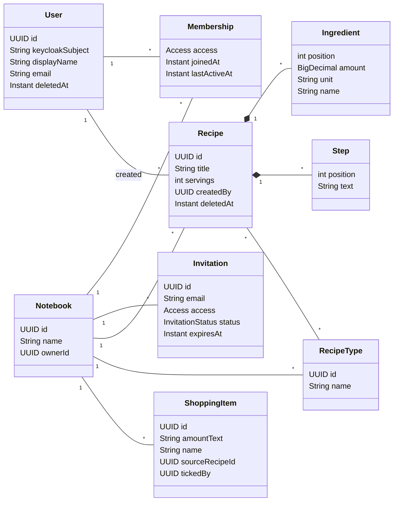
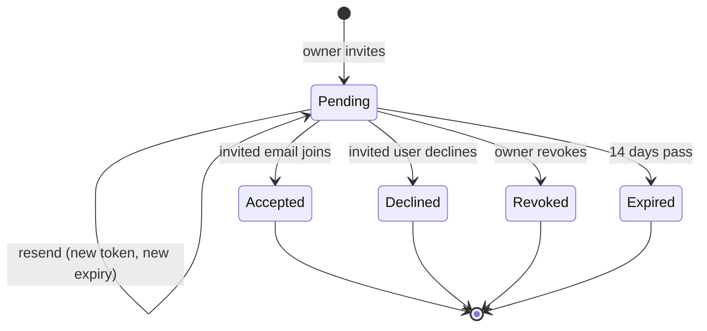
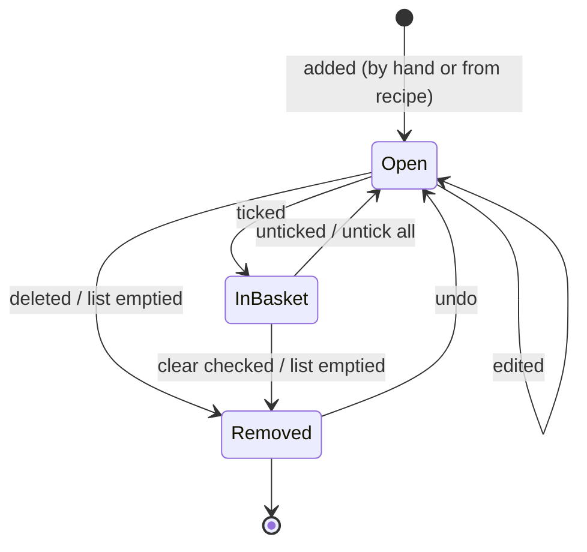
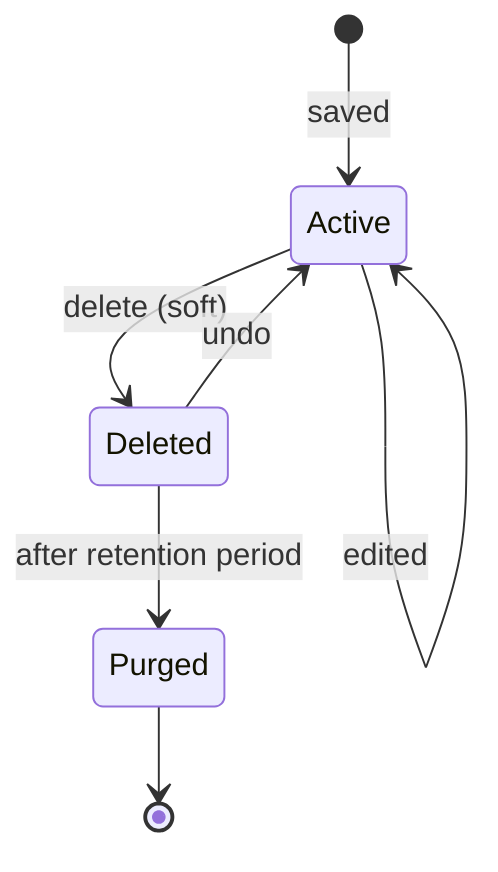

# Domain model

> Status: draft v0.1 · Tenancy key: `notebook_id` (shared schema, PostgreSQL row-level security).

## Table of contents

- [Bounded contexts](#bounded-contexts)
- [Entities](#entities)
- [Class diagram](#class-diagram)
- [Invariants](#invariants)
- [State diagrams](#state-diagrams)
  - [Invitation](#invitation)
  - [Shopping item](#shopping-item)
  - [Recipe](#recipe)
- [Domain events (internal, for later use)](#domain-events-internal-for-later-use)
- [Open questions](#open-questions)

## Bounded contexts

| Context | Responsibility | Aggregates |
|---|---|---|
| **Identity** | Authentication, credentials, Google linking, email verification, password reset | Keycloak (external) |
| **Accounts & Notebooks** | User profile, notebooks, memberships, invitations | `User`, `Notebook` (with `Membership`), `Invitation` |
| **Recipes** | Recipes, ingredients, steps, recipe types, photos | `Recipe`, `RecipeType` |
| **Shopping** | The notebook's shopping list | `ShoppingList` (with `ShoppingItem`) |

## Entities

| Entity | Key attributes | Notes |
|---|---|---|
| **User** | id (UUID), keycloakSubject (unique), displayName, email (unique, verified), avatarRef, createdAt, deletedAt | Profile mirror of the Keycloak identity. Soft-deleted users become "Former member". |
| **Notebook** | id, name (≤40), ownerId → User, createdAt | Tenant root. |
| **Membership** | notebookId, userId, access (`OWNER` \| `CAN_EDIT` \| `CAN_VIEW`), joinedAt, lastActiveAt | Unique (notebookId, userId). Owner is also a membership with `OWNER`. |
| **Invitation** | id, notebookId, email, access (`CAN_EDIT` \| `CAN_VIEW`), tokenHash, invitedBy → User, status, expiresAt, createdAt, acceptedBy, acceptedAt | One notebook, one email. Token is single-use; only its hash is stored. |
| **Recipe** | id, notebookId, title (≤120), description, servings, prepMinutes, cookMinutes, notes, createdBy → User, createdAt, updatedAt, deletedAt, image (see below) | Soft delete for Undo. `createdBy` never changes. |
| **Ingredient** | recipeId, position, amount (decimal, nullable), unit (text), name | Ordered list inside Recipe. |
| **Step** | recipeId, position, text | Ordered list inside Recipe. |
| **RecipeType** | id, notebookId, name, isDefault, deletedAt | Unique lower(name) per notebook. Many-to-many with Recipe. |
| **RecipeImage** (value) | kind (`UPLOAD` \| `ILLUSTRATION`), objectKey or illustrationKey | Uploads stored in S3-compatible object storage. |
| **ShoppingList** | notebookId (1:1) | Implicit per notebook. |
| **ShoppingItem** | id, notebookId, amountText, name, sourceRecipeId (nullable), addedBy, addedAt, tickedBy, tickedAt, updatedAt | Separate rows for duplicates. `sourceRecipeId` is display-only. |

## Class diagram

## Invariants

1. Every active user owns **at least one** notebook (enforced on delete-notebook, transfer-ownership and leave).
2. Each notebook has **exactly one** membership with `OWNER`, and `Notebook.ownerId` matches it.
3. An invitation can only be accepted by a user whose **verified email equals** `Invitation.email`.
4. An invitation is for exactly one notebook and one access level; accepting it when already a member just opens the notebook (no change).
5. `CAN_VIEW` members cannot modify anything in the notebook (recipes, types, shopping items).
6. Only `OWNER` can invite, change access, remove members, rename, transfer or delete the notebook.
7. Recipe type names are unique per notebook (case-insensitive).
8. `Recipe.createdBy` is immutable; after the creator's account is deleted it resolves to "Former member".
9. All tenant-owned rows carry `notebook_id`; every query runs with the current notebook set for row-level security.

## State diagrams

### Invitation

### Shopping item

### Recipe

## Domain events (internal, for later use)

`NotebookCreated`, `MemberJoined`, `MemberAccessChanged`, `MemberRemoved`, `InvitationSent`, `InvitationAccepted`, `InvitationRevoked`, `RecipeCreated`, `RecipeDeleted`, `ShoppingItemAdded`, `ShoppingItemTicked`, `UserDeleted`.
In v1 these can stay in-process (Spring application events); no message broker needed.

## Open questions

1. Ingredient units: free text vs a fixed list (affects scaling and future merging).
2. Retention period for soft-deleted recipes and deleted users' personal data.
3. Should `lastActiveAt` be tracked per notebook (People page) — privacy OK?
